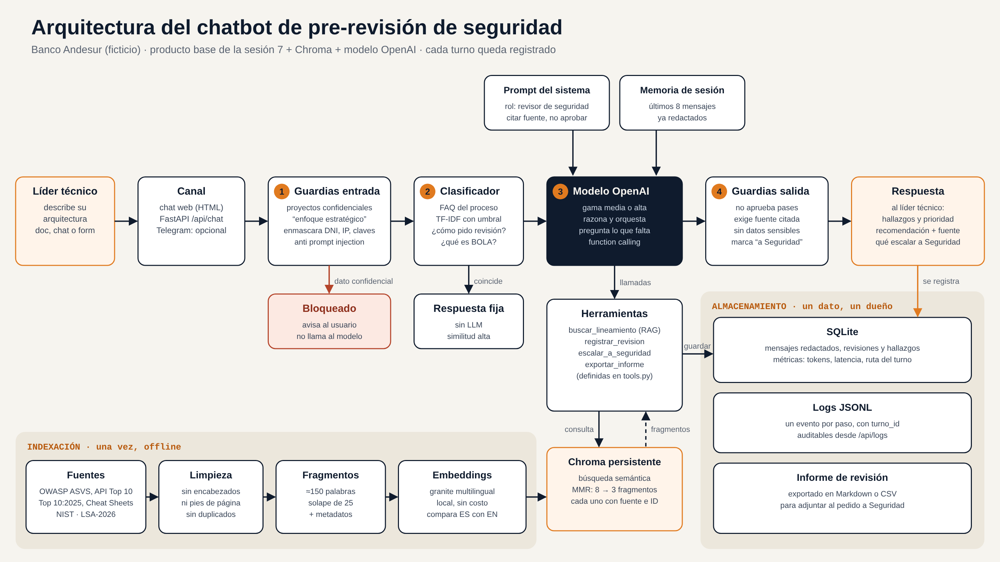

# Pre-revisión de seguridad de arquitecturas · Banco Andesur

Chatbot RAG que hace una **primera revisión de seguridad** del diseño de una solución web o API antes de que llegue al área de Arquitectura de Seguridad. El líder técnico describe su solución (en un documento de diseño, un mensaje o un formulario) y el bot:

- consulta los lineamientos internos y las guías públicas (OWASP, NIST);
- pregunta lo que falta;
- devuelve **hallazgos con prioridad, recomendación y fuente** (`POL-01.1`, `API1:2023`, `ASVS V8.2.1`);
- marca qué puntos **van a Seguridad**.

> **No reemplaza la revisión del área de Seguridad.** El bot nunca aprueba ni rechaza un pase a producción, no revisa código ni hace pentest. Toda respuesta lo recuerda.

Trabajo final del **Diploma en Diseño e Implementación de Chatbots (DMC)**. Banco Andesur es un banco **ficticio** y sus lineamientos (LSA-2026) son un documento de ejemplo.



## Contenido

- [Qué hace cada parte](#qué-hace-cada-parte)
- [Requisitos](#requisitos)
- [Instalación y ejecución](#instalación-y-ejecución)
- [Configuración (.env)](#configuración-env)
- [Ejemplos de uso](#ejemplos-de-uso)
- [Datos: fuentes, limpieza e índice](#datos-fuentes-limpieza-e-índice)
- [Pruebas y evaluación](#pruebas-y-evaluación)
- [Estructura del repositorio](#estructura-del-repositorio)
- [Capturas](#capturas)
- [Limitaciones](#limitaciones)
- [Licencias y atribución](#licencias-y-atribución)

## Qué hace cada parte

Un turno recorre estos pasos (`app/servicios/chat.py`). Lo que se puede decidir sin modelo se decide antes, y lo que no debe salir del banco nunca llega al proveedor.

| Paso | Qué hace | ¿Llama al modelo? |
|---|---|---|
| 1. Guardias de entrada (`app/seguridad/entrada.py`) | Enmascaran DNI, IP, tarjeta, número de cuenta, email, celular, claves y tokens. Bloquean nombres de proyectos confidenciales y la expresión "enfoque estratégico" (lista en `app/seguridad/terminos_bloqueados.json`) y los intentos de *prompt injection*. Un mensaje bloqueado **no se guarda**. | No |
| 2. Alcance (`app/seguridad/alcance.py`) | "Apruébame el pase", "revisa este código", "¿cuál es mi saldo?" reciben una respuesta fija. | No |
| 3. FAQ del proceso (`app/servicios/faq.py`) | Clasificador TF-IDF con umbral y margen: "¿cómo pido revisión?", "¿qué es BOLA?", "¿cuánto demora Seguridad?". | No |
| 4. Modelo + herramientas (`app/servicios/herramientas.py`) | *Function calling* con `buscar_lineamiento` (RAG), `registrar_revision`, `escalar_a_seguridad` y `exportar_informe`. Memoria: últimos 8 mensajes ya enmascarados. | Sí |
| 5. Guardias de salida (`app/seguridad/salida.py`) | Retiran frases de aprobación ("puede pasar a producción"). Rechazan hallazgos sin fuente válida: una regla `POL-XX.N` que no existe no pasa. Vuelven a enmascarar y agregan el aviso. | — |
| 6. Cierre (`app/datos/`) | SQLite (mensajes enmascarados, revisiones, hallazgos, escalamientos, métricas), log JSONL por turno e informe exportable en Markdown o CSV. | — |

Si no hay modelo (sin clave, sin red o con el proveedor caído), el bot responde en **modo demo**: muestra los lineamientos más cercanos a la descripción, con su cita.

**Recuperación (RAG):** Chroma persistente con distancia coseno y embeddings locales `ibm-granite/granite-embedding-97m-multilingual-r2` (compara preguntas en español con guías en inglés). Recupera los 8 fragmentos más cercanos, descarta los que no superan el umbral y el MMR elige 3 para el prompt. Si entre esos 3 no hay ninguna regla interna, la regla POL más cercana que supere el umbral reemplaza al tercero, porque toda observación debe citar la regla que incumple.

**Stack:** Python 3.12, FastAPI, Chroma, sentence-transformers (granite), spaCy (segmentación de oraciones), scikit-learn (FAQ), SQLite y un chat web en HTML. El acceso al modelo pasa por el router del curso (`app/llm/llm_router.py`), compatible con cualquier API estilo OpenAI y con respaldos `LLM_2_*`. No usa LangChain.

## Requisitos

- Windows 10/11 (principal) o cualquier sistema con **Python 3.12 de 64 bits**.
- Unos 3 GB libres: PyTorch, el modelo de embeddings (~200 MB) y la base vectorial.
- Internet la primera vez: dependencias, fuentes OWASP/NIST y modelo de embeddings.
- Una clave de API de **OpenAI** con un modelo de gama media o alta que soporte *function calling*. Sin clave, el bot funciona en modo demo.

## Instalación y ejecución

### Windows (recomendado)

```bat
git clone <url-del-repositorio> andesur
cd andesur
.\run.bat --tests        :: crea .venv con Python 3.12, instala requirements.txt, crea .env y corre las pruebas
```

Edita `.env` y completa `LLM_API_KEY` y `LLM_MODEL` (ver [Configuración](#configuración-env)). Luego:

```bat
.\run.bat --descargar    :: baja las fuentes OWASP y NIST (35 archivos, ~4 MB)
.\run.bat --indexar      :: construye la base vectorial Chroma (~2 min la primera vez)
.\run.bat --iniciar      :: abre http://127.0.0.1:8040
```

Usa `.\run.bat` (con `.\`): algunos equipos no ejecutan programas de la carpeta actual si no se indica la ruta. Otras opciones: `--evaluar` (casos de prueba), `--importar --desde "C:\mis_fuentes"` (fuentes locales), `--check`, `--diag`, `--reparar` y `--offline`.

### Manual (cualquier sistema)

```bash
python3.12 -m venv .venv
source .venv/bin/activate          # Windows: .venv\Scripts\activate
pip install -r requirements.txt
cp .env.example .env               # completa LLM_API_KEY y LLM_MODEL
python -m pytest                   # pruebas: sin red y sin clave
python -m scripts.descargar_fuentes
python -m scripts.indexar
python -m uvicorn app.main:app --port 8040
```

La documentación interactiva de la API queda en http://127.0.0.1:8040/docs.

### Sin internet o con tus propias fuentes

`scripts/importar_fuentes.py` suma archivos de una carpeta local (PDF, Markdown, HTML, TXT, CSV, DOCX y .zip) a `conocimiento/fuentes/propias/`:

- descarta los duplicados (mismo SHA-256) y el mismo documento en un formato peor (CSV > MD > HTML > DOCX > TXT > PDF);
- aplica las reglas de `conocimiento/reglas_importacion.json` (exclusiones, qué tomar de cada .zip y licencias).

Después hay que volver a correr `scripts.indexar`.

```bat
.\run.bat --importar --desde "C:\mis_fuentes" --simular
```

## Configuración (.env)

`.env` nunca se sube al repositorio. `.env.example` documenta todas las claves; las principales:

| Clave | Valor por defecto | Para qué |
|---|---|---|
| `LLM_BASE_URL` | `https://api.openai.com/v1` | Endpoint del modelo |
| `LLM_API_KEY` | *(vacío)* | Clave de OpenAI. Sin ella: modo demo |
| `LLM_MODEL` | *(vacío)* | Nombre del modelo (gama media o alta, con *function calling*) |
| `LLM_2_BASE_URL`, `LLM_2_API_KEY`, `LLM_2_MODEL` | — | Respaldo opcional si el principal falla |
| `LLM_TEMPERATURA` / `LLM_MAX_TOKENS` | `0.2` / `4000` | Una revisión con ~20 hallazgos en JSON ocupa ~3000 tokens |
| `RAG_UMBRAL` | `0.79` | Similitud mínima. Calibrada con `conocimiento/preguntas_control.json` |
| `RAG_K_INICIAL` / `RAG_K_FINAL` / `RAG_MMR_LAMBDA` | `8` / `3` / `0.5` | Top-k → MMR → fragmentos al prompt |
| `CHUNK_MAX_PALABRAS` / `CHUNK_OVERLAP_PALABRAS` | `150` / `25` | Tamaño y solape de los fragmentos |
| `FAQ_UMBRAL` / `FAQ_MARGEN` | `0.55` / `0.03` | Cuándo responde la FAQ sin modelo |
| `MAX_MENSAJES` / `MAX_VUELTAS` | `8` / `6` | Memoria de la sesión y rondas de herramientas por turno |
| `TERMINOS_PATH` | `app/seguridad/terminos_bloqueados.json` | Proyectos confidenciales y expresiones bloqueadas |
| `SSL_SISTEMA` | `1` | Usa los certificados del sistema operativo (antivirus o proxy que inspeccionan TLS). La verificación nunca se desactiva |
| `PORT` | `8040` | Puerto del servidor |

## Ejemplos de uso

En el chat web (http://127.0.0.1:8040) hay botones para los escenarios de la demo y para cargar los casos de prueba.

| Escenario | Mensaje | Qué responde |
|---|---|---|
| **Flujo feliz** | El texto de `casos_prueba/caso_01_autoconecta.txt` | Hallazgos con severidad, fuente (`POL-01.1`, `API1:2023`…) y marca "va a Seguridad"; revisión registrada, escalamiento e informe MD/CSV |
| **Error** | Descripción vacía, o modelo caído | Mensaje claro (HTTP 422) o modo demo con los lineamientos más cercanos |
| **Fuera de alcance** | "Apruébame el pase a producción" | Explica que eso lo decide Arquitectura de Seguridad, sin llamar al modelo |
| **Filtro** | "…la arquitectura del Proyecto Cóndor…" | Bloquea antes del modelo y no guarda el texto |
| FAQ | "¿Qué es BOLA?" | Respuesta fija con su fuente (API1:2023, POL-01.1) |

Por API:

```bash
curl -s http://127.0.0.1:8040/api/chat -H "Content-Type: application/json" \
  -d "{\"mensaje\": \"¿Qué es BOLA?\", \"sesion_id\": \"demo-1\"}"

# qué recupera el RAG, sin pasar por el modelo
curl -s "http://127.0.0.1:8040/api/buscar?q=SSRF%20URL%20enviada%20por%20el%20cliente"

# informe de una revisión (solo desde la sesión que la creó)
curl -s "http://127.0.0.1:8040/api/revisiones/REV-XXXXXX/informe.md?sesion_id=demo-1"
```

Formato de cada hallazgo (`hallazgos` en la respuesta de `/api/chat`):

```json
{"titulo": "Ubicación del vehículo sin validar dueño", "severidad": "alta",
 "descripcion": "…", "recomendacion": "…", "fuentes": ["POL-01.1", "API1:2023"],
 "requiere_seguridad": true, "nivel": "basico", "fuente_recuperada": true}
```

## Datos: fuentes, limpieza e índice

Los datos se usan para **consultar, no para entrenar**: el bot los recupera en cada pregunta.

| Fuente | Formato | Documentos | Fragmentos |
|---|---|---:|---:|
| Lineamientos LSA-2026 de Banco Andesur (ficticio, en el repo) | Markdown, una regla por fragmento | 1 (15 políticas, 73 reglas) | 73 |
| OWASP ASVS 5.0.0 | CSV oficial, un requisito por fragmento | 1 | 345 |
| OWASP API Security Top 10 2023 | Markdown | 10 | 91 |
| OWASP Top 10:2025 (español) | Markdown | 10 | 109 |
| OWASP Cheat Sheets (Authorization, REST, JWT, Microservices, SSRF, File Upload, Logging, Secrets, Input Validation, Mass Assignment) | Markdown | 10 | 357 |
| NIST SP 800-204, 800-207, 800-218, 800-63B-4 | PDF | 4 | 866 |
| **Total** | | **36** | **1841** |

Fragmentos de hasta 150 palabras con 25 de solape, cortados por oraciones con spaCy. Las reglas POL y los requisitos ASVS se indexan enteros, porque cada uno es la unidad que se cita. Detalle por fuente en [docs/reporte_indice.md](docs/reporte_indice.md).

- **Procedencia:** `scripts/descargar_fuentes.py` baja de los repositorios oficiales de OWASP (fijados a un commit) y de nvlpubs.nist.gov. Valida cada archivo y anota URL, licencia y SHA-256 en `conocimiento/fuentes/manifiesto.json`.
- **Limpieza** (`app/rag/cargadores.py`):
  - PDF: quita encabezados y pies de página que se repiten (1057), números de página e índices (235 líneas) y une las palabras cortadas con guion (99).
  - Markdown y HTML: quita imágenes, enlaces y etiquetas, además de secciones sin valor para recomendar, como tablas de cifras, listas de CWE y bibliografía.
  - Todos: elimina párrafos y fragmentos duplicados.
- **Validación:**
  - Los metadatos de cada fragmento guardan fuente, cita, sección, página, licencia y la "Revisión obligatoria" de cada regla.
  - 16 preguntas de control (`conocimiento/preguntas_control.json`) aciertan 16/16: la cita esperada está entre los 3 fragmentos que llegan al prompt.
  - El índice nunca incluye los casos de prueba ni la hoja de respuestas.

## Pruebas y evaluación

```bat
.\run.bat --tests       :: 161 pruebas, sin red y sin clave (RouterFalso + Chroma temporal)
.\run.bat --evaluar     :: escenarios + 3 casos contra la hoja de respuestas
```

`casos_prueba/` contiene:
- 3 casos basados en apps vulnerables conocidas (crAPI, VAmPI y Juice Shop) y adaptados a un banco;
- la hoja de respuestas, con **60 hallazgos** (42 básicos y 18 avanzados), cada uno con su referencia OWASP y la regla POL que debería citar el bot;
- 5 casos trampa: un diseño bien hecho, un proyecto confidencial, "enfoque estratégico", inyección y datos sensibles;
- 10 escenarios.

`scripts/evaluar_casos.py` mide la detección de fallas básicas y avanzadas, los hallazgos no esperados, las citas correctas (regla y política POL), la marca "va a Seguridad", la latencia p50/p95 y los tokens. Escribe [docs/resultados_evaluacion.md](docs/resultados_evaluacion.md) y un `emparejamientos.csv` para revisar cada par a mano: el emparejamiento es automático (similitud semántica más la regla citada) y es una aproximación.

## Estructura del repositorio

```
├─ app/
│  ├─ main.py            API FastAPI (chat, revisiones, informes, búsqueda, logs, métricas)
│  ├─ config.py          lectura del .env y umbrales
│  ├─ seguridad/         guardias de entrada, alcance y salida; validación de citas
│  ├─ rag/               cargadores por formato, fragmentos, embeddings, Chroma + MMR
│  ├─ servicios/         turno del chat, FAQ, herramientas y prompt del sistema
│  ├─ datos/             SQLite, logs JSONL e informes MD/CSV
│  ├─ llm/               router del curso (copia local)
│  └─ static/            chat web
├─ conocimiento/         lineamientos LSA-2026 (en el repo) y fuentes descargadas (fuera de Git)
├─ casos_prueba/         casos, trampas, escenarios y hoja de respuestas
├─ scripts/              descargar_fuentes, importar_fuentes, indexar, evaluar_casos
├─ tests/                pruebas con RouterFalso (sin red ni clave)
├─ docs/                 arquitectura, reporte del índice, resultados y capturas
├─ run.bat · requirements.txt · .env.example · pytest.ini · LICENSE
```

## Capturas

Las capturas van en `docs/capturas/`:

1. `01_flujo_feliz.png`: caso AutoConecta con las tarjetas de hallazgos y "va a Seguridad".
2. `02_informe.png`: informe Markdown exportado.
3. `03_error.png`: descripción vacía y modo demo.
4. `04_fuera_de_alcance.png`: "Apruébame el pase".
5. `05_filtro.png`: "Proyecto Cóndor" bloqueado.

## Limitaciones

- El bot hace una **pre-revisión del diseño descrito**: no ve el código ni la infraestructura real, y lo que no se describe no se revisa.
- La calidad de los hallazgos depende del modelo. El docente recomendó uno de inteligencia media o alta.
- El umbral de similitud separa casi todo lo ajeno al tema, pero no todo ("¿cuál es mi saldo?" da una similitud de 0,80 a 0,82, según la construcción del índice). Esos casos los resuelven las guardias de alcance.
- Es un servicio local de demostración: no tiene autenticación de usuarios. Las revisiones se aíslan por sesión.

## Licencias y atribución

- Código: [MIT](LICENSE).
- **OWASP** ASVS 5.0, API Security Top 10 2023, Top 10:2025 y Cheat Sheet Series: © OWASP Foundation, licencia [CC BY-SA 4.0](https://creativecommons.org/licenses/by-sa/4.0/). Se descargan sin modificar desde github.com/OWASP; el índice guarda fragmentos con su cita.
- **NIST** SP 800-204, 800-207, 800-218 y 800-63B-4: publicaciones del Gobierno de EE. UU., de dominio público.
- Los lineamientos LSA-2026, los casos de prueba y Banco Andesur son ficticios, creados para este trabajo. Los casos se inspiran en OWASP crAPI, VAmPI y OWASP Juice Shop.
- `app/llm/llm_router.py` es el router del curso DMC, incluido para que el repositorio funcione solo.
